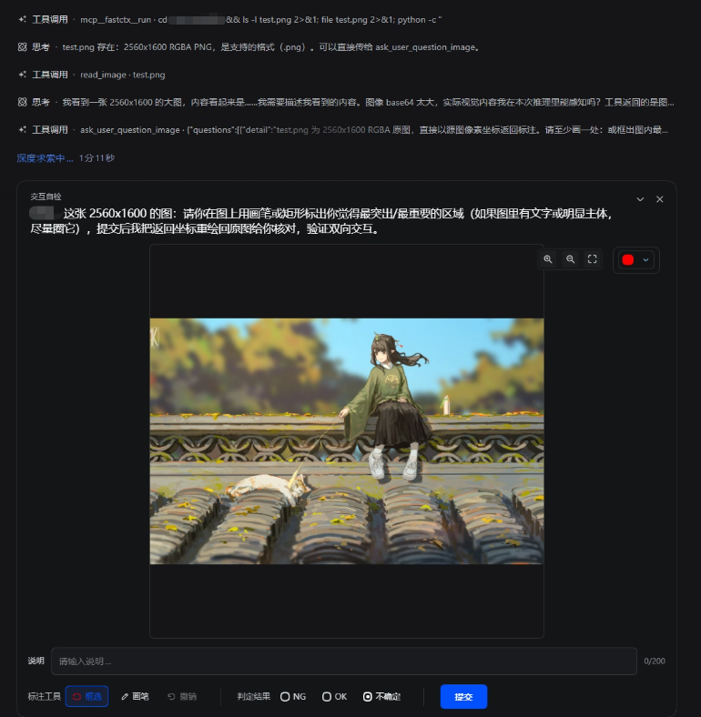

# dsh-image-question

给 DSH Web 的**图片标注提问**插件：Agent 带图提问，用户在浏览器里看图、缩放平移、框选或画笔标注、判定 NG/OK/不确定、写说明；Agent 拿回的是**原图坐标系**下的结构化结果。

> Ask with an image, annotate in the browser, get back structured source-pixel coordinates.
> Zero peer dependencies. No build step. Both halves are hand-written artifacts.

## 界面截图



---

## 1. 它解决什么

Agent 判断不了的事情里，有很大一类必须由人看图：截图取图失败要确认、检测结果要判 NG/OK、UI 细节要指出位置。官方 `ask_user_question` 只能传文字，位置与范围说不清楚；把图丢进对话，用户回来也只能用「左上角那个」「大概中间」描述。

本插件注册一个工具 `ask_user_question_image`：Agent 给出**本地图片文件路径**，Host 读取并作为附件入库，浏览器端接管提问卡片渲染出标注界面，用户在图**原图坐标系**上标注并提交，Agent 收到与缩放、平移、窗口尺寸、设备像素比**无关**的坐标。

## 2. 用户侧能做什么

| 能力 | 说明 |
|---|---|
| 看图 | 滚轮缩放、拖拽平移、三档缩放按钮 |
| 框选 | `rect`，拖出矩形区域 |
| 画笔 | `brush`，按住连续画；单击落点进入套索模式，双击或右键闭合 |
| 重画 | 清空当前题的所有标注 |
| 撤销 | 逐步回退，每一步都可回退 |
| 调色 | 4 色调色板，默认 `#fa0202` |
| 判定 | NG / OK / 不确定 |
| 说明 | 自由文本，上限 200 字 |
| 提交 | 整批一次提交，结果按 `id` 回传 |

## 3. 工具契约

工具名 `ask_user_question_image`，零 peer 依赖，注册时提交原始 JSON-Schema。

入参：

```jsonc
{
  "questions": [{
    "id": "q1",                          // 必填，回传时原样带回
    "question": "这张图算 NG 吗？",        // 必填
    "source_image": "D:/path/to/a.png",  // 必填，绝对路径；路径本身不上 wire
    "header": "NG 标注",                  // 可选，卡片短标题
    "detail": "补充说明文字",              // 可选
    "sentinel": "PROBE-42"               // 可选，端到端关联用的不透明回环令牌
  }],
  "timeout_ms": 600000                   // 可选，默认 10 分钟
}
```

约束：一道题**恰好一张图**；`source_image` 支持 `.png` / `.jpg` / `.jpeg` / `.webp` / `.gif`；整批一次提交。

返回：

```jsonc
{
  "answers": [{
    "id": "q1",
    "selected": ["NG"],
    "mode": "annotated",                 // 或 "generic-fallback"
    "verdict": "ng",                     // ng | ok | unsure
    "note": "色差超标",
    "annotations": [ /* 原图像素坐标下的矩形与笔迹 */ ],
    "image": { "width": 4000, "height": 4000 },
    "source_path": "D:/path/to/a.png",   // 仅回给模型，不上 wire
    "raw_custom": "{...}"
  }]
}
```

失败一律作为**数据**返回，不是中断的工具调用：`CALLER_NOT_LIVE`、`EMPTY_QUESTIONS`、`IMAGE_ANNOTATION_BUSY`、`UNSUPPORTED_MEDIA_TYPE`、`IMAGE_READ_FAILED`、`IMAGE_ADMISSION_FAILED`，超时则返回超时错误。

坐标系声明为 `source-oriented-pixel-edge`，原点左上、x 向右、y 向下，尺寸取**原图**尺寸（`originalDimensions ?? width`）。

## 4. 安装

```bash
# 在 profile 清单里加两处（~/.dsh/profiles/<profile>/package.json）
#   dependencies:      "dsh-image-question": "link:/abs/path/to/dsh-image-question/plugin"
#   dsh.profile.bundles: 追加 "dsh-image-question"
cd ~/.dsh/profiles/<profile> && pnpm install
dsh --profile <profile> --host 127.0.0.1 --port 3101 --no-open
```

`plugin/package.json` 自带 `dsh.bundle` 与 `dsh.client` manifest，`cordis.patch.yml` 随插件一起生效，不需要额外传 `--patch`。

开发期叠加（`dsh --profile <profile> --patch dev/patch.yml`）与正式安装**互斥**：两者同时存在会让同一插件被注册两次，启动直接失败（`resolves from multiple active Loader sources`）。要用 overlay 就先卸掉 profile 里那两行。

改代码怎么生效：两个半边都是手写产物、**没有构建步骤**，但 Host 会快照 bundle 字节，所以 `plugin/lib/index.js`、`plugin/client.js`、`plugin/cordis.patch.yml` 的改动都靠**重启**生效。

## 5. 实现要点

Host 半边只做三件事：注册工具、把图片经 `ctx.attachments.saveImage()` 入库并签发**每图一个的不透明能力令牌**、通过只读 Fetch 路由 `/api/image-question.view` 按令牌发字节。经 `saveImage()` 入库的附件不进会话事件流，官方会话授权图片路由服务不了它（会报 `ATTACHMENT_NOT_REFERENCED`），这正是自建只读路由的原因。

令牌表只是叠在既有附件库上的**授权映射**：提问前签发、按同一引用读回、结算即撤销。它不是第二个图库、不是上传端点、不是文件缓存、不是归一化管线，也从不接受文件系统路径。未知、过期、已撤销的令牌一律返回相同的 404，不泄漏是哪一种。

并发：同一个 Agent 同时只允许一个未答的图片提问，第二次调用在读取任何文件之前就被拒绝（`IMAGE_ANNOTATION_BUSY`），因此被拒的调用不留孤儿附件、不留无人回答的卡片。不同 Agent 互不干扰，父 Agent 与子 Agent 可各问各的。

`cordis.patch.yml` 把 `attachment-local` 行的保真上限抬到 4096×4096（`normalizedImageMaxPixels` / `normalizedImageMaxBytes` → 16777216，`normalizedImageMaxDimension` → 8192），这样 4000×4000 的源图不被降采样、可按原尺寸读取；它只改该行的 `config`，不编辑任何官方文件。

Client 半边是一个 bundle 注册两个 id（`dsh-image-question` 与 `dsh-image-question/logic`），用 `priority: -100` 接管官方提问卡片的 chain 选举——chain 规则是 `(priority ?? 0)` **升序**、数值最小者先被调用。selector 只认带 `imageAnnotation` 标记的题，其余（含带 `intent` 的 plan-review）一律返回 `null`，让位官方卡片。

## 6. 已知限制

- 只在 **Web** 平台有界面（`dsh.client.platform = "web"`）；非 Web 环境里工具仍注册，但没有卡片可答。
- 一道题恰好一张图，一个 Agent 同时一道未答的图片提问。
- 矮窗口下卡片完整可见，但会话区剩余可见高度随窗口变矮而变小（图片区高度取 `min(100%, 50vh)`）。
- 取图失败提示、DPR 1.25、自然时钟上界等边界项未经运行时穷尽验证。

## 7. 目录

```
plugin/
├── package.json          dsh.bundle + dsh.client manifest
├── cordis.patch.yml      bundle 层 patch（附件保真上限 + insert 插件行）
├── lib/index.js          Host 半边：工具注册、附件入库、只读视图路由
├── lib/token-store.js    能力令牌表（签发 / 查找 / 撤销 / 过期）
├── lib/concurrency.js    Agent 身份 + 单飞守卫（claim / release）
└── client.js             Client 半边：接管提问卡片的标注界面
AGENTS.md                 开发守则（本项目的长期规矩与踩坑清单）
```
